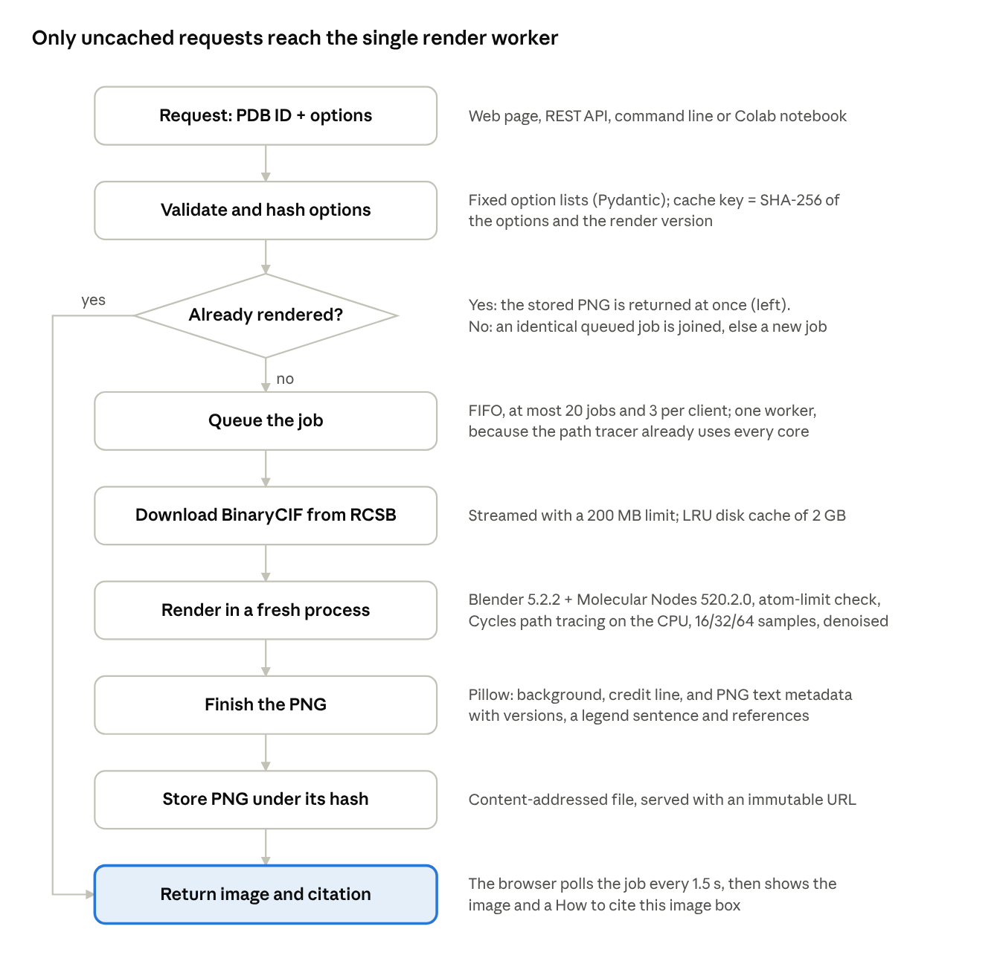
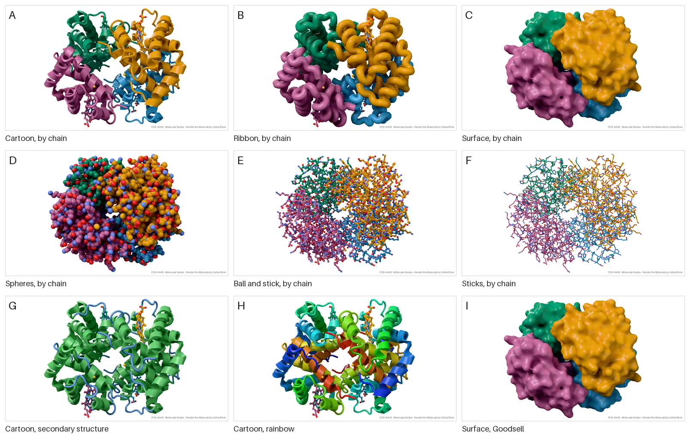
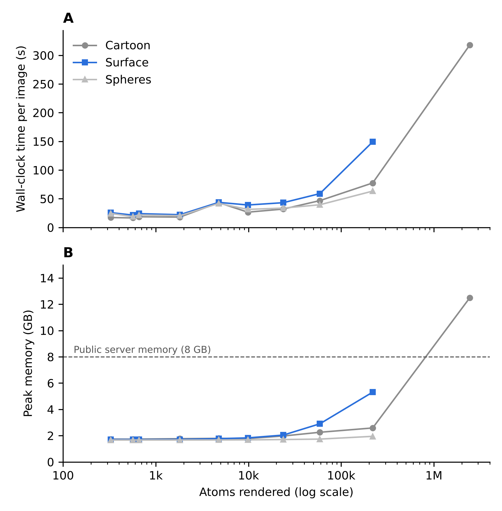
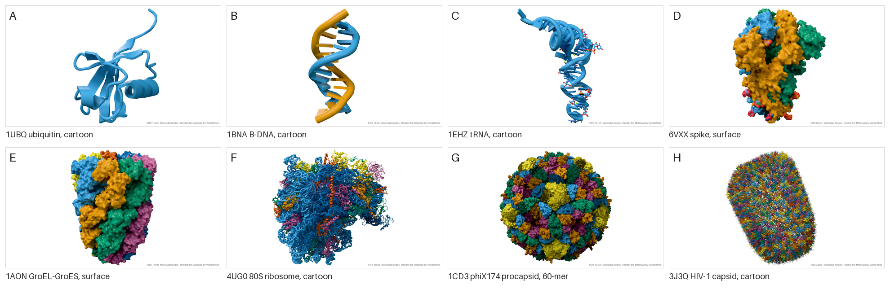
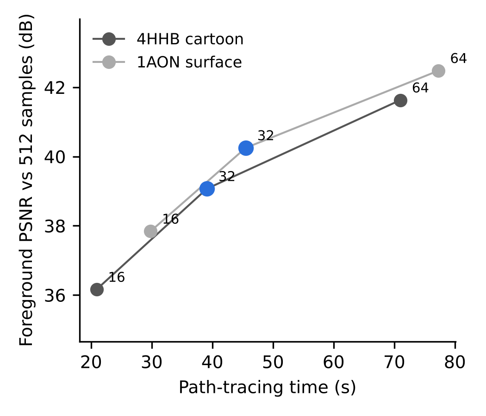
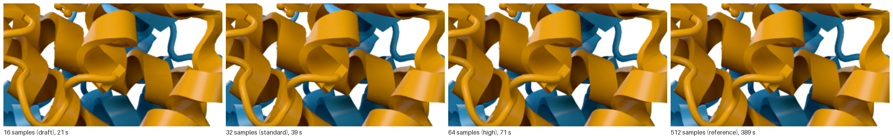
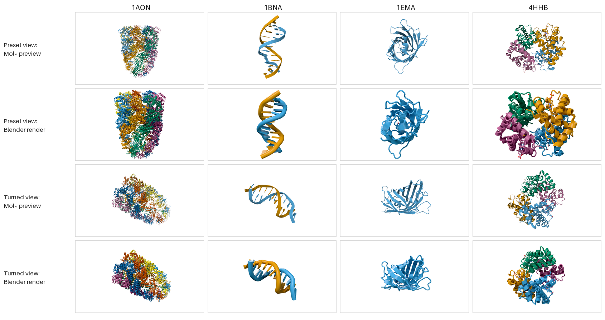

# Render the Molecule: manuscript draft

*Working copy exported from the editable manuscript. Figures 1, 3 and 5 are drawn in the editable version; the files linked here are static renderings of the same data for journal submission.*

## Title page

**Title:** Render the Molecule: zero-installation, path-traced images of Protein Data Bank entries with Blender and Molecular Nodes

**Running title:** Path-traced PDB images from an ID

**Article type:** Software / tools article (fits Protein Science "Tools for Protein Science"; condensable to a Bioinformatics Application Note of about 2,600 words)

**Author:** Vishal Bhoir (ORCID [0009-0004-8803-1967](https://orcid.org/0009-0004-8803-1967)). Affiliation, postal address and corresponding-author email to be added.

**Keywords:** molecular visualization; Protein Data Bank; path tracing; Blender; Molecular Nodes; scientific figures; reproducibility; software citation

**Software version described:** 0.2.0, repository commit 12a84b1 (13 November 2026): Mol\* 3D preview with "Render this view", colour-blind-safe palettes shared by preview and render, and camera-relative studio lighting.

**Before submission (note to the author, delete afterwards):** release v0.2.0 on GitHub so that Zenodo assigns its DOI; images rendered from commit 12a84b1 still carry the label 0.1.0 in their credit line and metadata, so bump the version in app/about.py and CITATION.cff first. Then put the new DOI in the Bhoir (2026) reference.

| Candidate journal | Fit | Check before submitting |
| --- | --- | --- |
| Protein Science (Tools for Protein Science) | Publishes Mol\*, ChimeraX and RCSB tool papers | Word limit and figure count |
| Bioinformatics (Application Note) | Published NGL, 3Dmol.js, iCn3D and The Protein Imager | 2,600 words, one figure |
| Journal of Molecular Biology (Computation Resources) | Published EzMol | Scope statement |
| Nucleic Acids Research (Web Server issue) | Published Mol\* and NGL | The mandatory name and email field may count as a login requirement |

## Abstract

**Motivation:** Path-traced images of macromolecules convey shape and depth through physically based lighting, but making them has meant installing and learning professional 3D software.

**Results:** We present Render the Molecule, a web application, command-line tool and Google Colab notebook that renders any Protein Data Bank (PDB) entry from its identifier with Blender's Cycles path tracer through Molecular Nodes. An embedded Mol\* preview lets users compose the view, and the render reproduces it: with the preview's camera, the rendered molecule was centred within 0.9% of the image width of the preview's. The tool offers six representations, a colour-blind-safe chain palette and biological assemblies, and embeds the software versions, source entry and references in every PNG file. On ten entries spanning 327 to 2.44 million atoms, every image of an entry up to 58,870 atoms, a size range that covers 97.9% of the PDB, rendered in 17–59 s on four CPU threads with at most 2.9 GB of memory. The default preset reached a structural similarity of 0.983–0.991 against 512-sample references, and repeated renders were byte-identical across processes and thread counts, which makes content-addressed caching exact. The largest entry, a 2.44-million-atom capsid, rendered in 318 s but needed 12.5 GB of memory, more than the public server provides.

**Availability and implementation:** Free and open source under GPL-3.0-or-later at [github.com/vishalbhoir18/renderthemolecule](https://github.com/vishalbhoir18/renderthemolecule), version 0.1.0 archived at [doi:10.5281/zenodo.23960655](https://doi.org/10.5281/zenodo.23960655). Web application: [vishalbhoir18--render-the-molecule.us-east.modal.run](https://vishalbhoir18--render-the-molecule.us-east.modal.run).

**Supplementary information:** Benchmark scripts, per-render results and all benchmark images are in the repository's paper folder.

## 1. Introduction

Images of three-dimensional macromolecular structures are how most readers first meet a structural result. They appear in research figures, graphical abstracts, textbooks, grant proposals and outreach material, and they shape how a structure is understood well beyond the community that solved it (O'Donoghue et al., 2010; Johnson & Hertig, 2014; Goodsell & Jenkinson, 2018; Martinez et al., 2019; Torrez et al., 2026). The supply of structures to depict keeps growing. On 5 November 2026 the RCSB Protein Data Bank (PDB) listed 262,922 released entries, and RCSB.org now serves more than one million computed structure models next to them (Berman et al., 2000; Bittrich et al., 2023; Varadi et al., 2024).

The software used to make these images falls into two broad groups. Desktop programs such as VMD, PyMOL and UCSF ChimeraX combine analysis with high-quality rendering, including ray tracing and ambient occlusion (Humphrey et al., 1996; Goddard et al., 2018; Pettersen et al., 2021). Browser viewers built on WebGL, among them JSmol, NGL, 3Dmol.js, LiteMol, iCn3D and Mol\*, removed installation altogether and made interactive viewing routine on structure databases (Hanson et al., 2013; Rose & Hildebrand, 2015; Rego & Koes, 2015; Sehnal et al., 2017; Rose et al., 2018; Wang et al., 2020; Sehnal et al., 2021). Real-time engines approximate global illumination in screen space to stay interactive (Rose et al., 2026). Lighting is not decoration: ambient occlusion and related shadowing cues measurably improve the perception of molecular shape, pockets and depth (Tarini et al., 2006; Wahle & Wriggers, 2015; Kozlíková et al., 2017).

Physically based path tracing, which solves the rendering equation by Monte Carlo sampling of light paths (Kajiya, 1986), gives these cues without approximation. It has been available to structural biologists for decades through programs such as Raster3D (Merritt & Bacon, 1997), and in illustrative form through Goodsell's non-photorealistic style (Goodsell et al., 2019). General-purpose 3D suites, Blender in particular, offer production path tracers, but setting up a molecular scene in them is laborious even for experts (Durrant, 2022). A series of bridges has lowered that barrier: ePMV embedded molecular modelling in animation packages (Johnson et al., 2011), BioBlender added surface properties and motion (Andrei et al., 2012), and BlendMol and Pyrite imported VMD, PyMOL and molecular dynamics scenes into Blender (Rajendiran & Durrant, 2018; Durrant, 2019). Molecular Nodes now builds molecular geometry natively inside Blender from PDB, mmCIF and trajectory files using Blender's procedural Geometry Nodes system (Johnston & Molecular Nodes contributors, 2026). Each of these tools still requires installing Blender and learning its interface.

A few services render on a server instead. EzMol guides users through a short wizard to an image (Reynolds et al., 2018), The Protein Imager couples an online viewer to automated high-quality server-side rendering (Tomasello et al., 2020), and Prot2Prot imitates photorealistic styles with a neural network that runs in the browser (Durrant, 2022). To our knowledge, no service yet returns a path-traced Blender image from nothing more than a PDB identifier, and none reports what such images cost to compute across the size range of the PDB.

Images also travel without their provenance. A figure rarely records which program, version and settings produced it, although software citation principles and the FAIR principles for research software ask for exactly that (Smith et al., 2016; Katz et al., 2021; Barker et al., 2022).

Here we describe Render the Molecule, a free, open-source web application, command-line tool and Google Colab notebook that turns a PDB identifier into a path-traced image rendered by Blender and Molecular Nodes. An embedded Mol\* preview lets users compose the view interactively, and the render reproduces that exact view with physically based lighting. Every image carries its credits and a ready-made citation in its file metadata. We benchmark version 0.2.0 on ten PDB entries spanning 327 to 2.44 million deposited atoms and report render time, peak memory, image quality against a high-sample reference, repeatability, agreement between preview and render, and the limits of the current deployment.

## 2. Materials and methods

### 2.1 Design goals

Render the Molecule was built around six requirements: (i) no installation on the user's side; (ii) publication-quality output from default settings; (iii) a view the user can compose interactively and see before rendering; (iv) a complete and machine-readable record of provenance in every image; (v) bit-for-bit reproducible renders for a given software version and option set; and (vi) an operating cost low enough for a free public service.

### 2.2 Architecture and request flow

The web application is written in Python 3.13 with FastAPI (Figure 1). Typing a PDB identifier loads the entry into an embedded Mol\* viewer (Sehnal et al., 2021), served by the application itself, which mirrors the chosen representation, colours, ligands, assembly, background and image aspect ratio. A render request names the identifier, ten options and, if the user has turned or zoomed the preview, the preview's camera: its position, target and up direction in ångström and its vertical field of view. Pydantic models validate the request against fixed option lists, check the camera's geometry and round its values, and accept both classic four-character identifiers and the extended wwPDB format (pdb\_0000xxxx). The validated options, together with a render-version string, are serialised to canonical JSON and hashed with SHA-256. The digest names the output file, so identical requests, including identical views, map to one image: a cached image is returned at once, and a request identical to one already queued joins that job instead of creating a new one.

Uncached jobs enter an in-memory first-in, first-out queue served by a single worker thread. One worker is deliberate, because the path tracer already uses every available CPU core. The queue holds at most 20 jobs and each client at most three active jobs. The browser polls a status endpoint and shows the user's position in the queue. A command-line interface, which also accepts a camera, and a Google Colab notebook call the same rendering code; the notebook runs on Google's free cloud machines, a route that ColabFold showed can bring demanding structural software to users without local hardware (Mirdita et al., 2022).

**Figure 1.** Request flow. The 3D preview loads the entry from the server's cache and lets the user set the view. The render request is validated and hashed; a cached image is returned at once (left branch), and only new requests are queued and path-traced in a fresh Blender process.

### 2.3 Structure retrieval

Coordinates are downloaded from the RCSB model server in BinaryCIF, a compact binary encoding of PDBx/mmCIF (Sehnal et al., 2020; Westbrook et al., 2022). Downloads are streamed with a 200 MB limit, decompressed if gzip-encoded, and written atomically. The same cached file feeds the 3D preview and the render, so the render that usually follows a preview does not download the entry again. Structures and renders are kept in two disk caches of 2 GB each, pruned least-recently-used first.

### 2.4 Scene construction and rendering

Each job runs in a new Python process that imports Blender 5.2.2 (Blender Online Community, 2026) as the bpy module and Molecular Nodes 520.2.0 (Johnston & Molecular Nodes contributors, 2026). No Blender executable or add-on installation is involved. Running every render in its own process isolates the web server from Blender's global state, memory growth and crashes. Molecular Nodes parses the file with Biotite (Kunzmann & Hamacher, 2018) and MDAnalysis (Michaud-Agrawal et al., 2011) and builds geometry with Geometry Nodes.

Users choose one of six representations (cartoon, ribbon, molecular surface, spheres, ball-and-stick, sticks), four colour schemes, four materials, four output sizes, three quality levels and three backgrounds, and either one of seven preset viewpoints or the camera of the 3D preview. Chains take colours from the colour-blind-safe Okabe–Ito palette (Wong, 2011) in the order of their identifiers. The Goodsell-like scheme uses the same chain colours with darkened carbons; the rainbow scheme runs from blue to red along each chain's protein or nucleic-acid residues by residue number, with ligands and water grey; and the secondary-structure scheme uses Molecular Nodes' colours. The preview applies the same palettes, so its colours match the render's. Water is hidden in all-atom representations. For cartoon and ribbon, non-polymer, non-water atoms (ligands, cofactors and ions) are overlaid as ball-and-stick. Biological assemblies are built from the first assembly's symmetry operators in the mmCIF file (Krissinel & Henrick, 2007).

Before any geometry is built, the atom count after assembly expansion is checked against a per-representation limit: 3,000,000 atoms for cartoon and ribbon, 1,000,000 for surface and spheres, and 300,000 for ball-and-stick and sticks. Requests above the limit are refused with a message that suggests a cheaper option.

Images are rendered with Blender's Cycles path tracer on the CPU with the sampling settings Molecular Nodes applies: adaptive sampling with a noise threshold of 0.01, up to 12 light bounces (4 diffuse, 4 glossy), Intel Open Image Denoise guided by albedo and normal passes, and a fixed random seed. The three quality levels cap sampling at 16, 32 and 64 samples per pixel. Colours are mapped with the Khronos PBR Neutral view transform, which keeps saturated colours as chosen. Lighting imitates the preview: three sun lights are placed relative to the camera (a key light from the upper left, a fill light from the right and a rim light from behind, with strengths 3.5, 1.0 and 1.5) under a dimmed environment light (strength 0.6), so every view is lit alike. The default material is glossy, with a roughness of 0.35.

When a camera is supplied, Blender's camera is given the same position, target, up direction and vertical field of view, scaled by the factor of 0.1 that Molecular Nodes applies to coordinates; otherwise a preset view frames the molecule. The film is transparent, and the chosen background is composited afterwards, so lighting is identical whatever the background colour. The number of render threads is read from the container's cgroup CPU quota rather than the host's CPU count.

### 2.5 Provenance and citation

Each image carries credits in two forms. A small credit line (for example, "PDB 4HHB · Molecular Nodes · Render the Molecule by Vishal Bhoir") is drawn in the lower right corner, scaled to the image width; users may switch it off. PNG text chunks always record the title, the software versions, the source entry with its RCSB link, a one-sentence legend for a figure caption, and APA-formatted references to the tool, Molecular Nodes, Blender, the PDB and the primary publication of the entry. The same text is shown after each render in a "How to cite this image" box. The software is archived on Zenodo (Bhoir, 2026) and described by a CITATION.cff file, following software citation principles (Smith et al., 2016; Katz et al., 2021).

### 2.6 Deployment and testing

The application ships as a Docker image based on python:3.13-slim with Mesa libraries, so Blender starts without a GPU (Boettiger, 2015); the Mol\* viewer (MIT licence) is bundled with it. The public instance runs on Modal as a single container with two physical CPU cores and 8 GB of memory, which starts on the first request and stops 300 s after the last. All Python dependencies are pinned to exact versions. A suite of 151 automated tests covers validation, caching, the job queue, camera handling, the colour palettes, the citation text, the notebook and real renders of PDB 1CRN, one of which checks that the molecule lands where a given camera puts it; continuous integration builds and starts the container on every push.

Users give their name, email address, institution and country before rendering. A privacy notice states what is recorded, for what purpose, where it is kept and how to have it corrected or deleted. The operator may record these details with each render in a private Google Sheet; they are never part of the image cache key or of shared links.

### 2.7 Benchmark protocol

All measurements were made on one Linux virtual machine (Intel Xeon processor at 2.10 GHz, 4 vCPUs, 15 GB RAM, Linux 6.18, Python 3.13.18) with version 0.2.0 of the software (repository commit 12a84b1) and the pinned dependencies of Section 2.4. A benchmark script (paper/benchmark/run\_benchmark.py in the repository) downloads each structure with the application's own code and runs the application's own render module in a fresh process for each image, exactly as the web server does. Unless varied, every render used the defaults: 1280 × 720 pixels, Standard quality (32 samples), glossy material, default viewpoint, colour by chain, white background, ligands shown and credit line on, with 4 render threads.

The panel comprised ten PDB entries chosen to span four orders of magnitude in size, three experimental methods and protein, DNA and RNA (Table 1).

**Table 1.** Benchmark panel. Deposited atom counts, methods and resolutions from the RCSB Data API on 5 November 2026.

| PDB ID | Molecule | Method | Resolution (Å) | Deposited atoms |
| --- | --- | --- | --- | --- |
| 1CRN | Crambin | X-ray | 1.50 | 327 |
| 1BNA | B-DNA dodecamer | X-ray | 1.90 | 566 |
| 1UBQ | Ubiquitin | X-ray | 1.80 | 660 |
| 1EHZ | Yeast tRNA-Phe | X-ray | 1.93 | 1,821 |
| 4HHB | Human deoxyhaemoglobin | X-ray | 1.74 | 4,779 |
| 1CD3 | Bacteriophage φX174 procapsid (asymmetric unit) | X-ray | 3.50 | 9,851 |
| 6VXX | SARS-CoV-2 spike, closed state | Cryo-EM | 2.80 | 23,694 |
| 1AON | GroEL–GroES–ADP chaperonin | X-ray | 3.00 | 58,870 |
| 4UG0 | Human 80S ribosome | Cryo-EM | 3.60 | 218,776 |
| 3J3Q | Complete HIV-1 capsid | Cryo-EM + MD model | n/a | 2,440,800 |

Eight experiments were run. E1 rendered every entry as cartoon, surface and spheres to measure how cost scales with size. E2 rendered haemoglobin (4HHB) in all six representations and in three colour schemes. E3 rendered 4HHB (cartoon) and 1AON (surface) at the three quality levels and at 512 samples as a reference. E4 varied the number of render threads (1, 2 and 4). E5 rendered the φX174 procapsid with and without its 60-copy biological assembly. E6 rendered the same request twice to test repeatability, and E7 varied the output size.

E8 compared the 3D preview with the render. For green fluorescent protein (1EMA), 4HHB, 1BNA and 1AON, the Mol\* preview was captured in a headless browser (Chromium with software WebGL) in its preset view and again after a fixed drag, together with the camera the page sends with "Render this view" (paper/benchmark/capture\_previews.js). Each view was then rendered as a cartoon with the credit line off: the preset view without a camera, as the page sends it, and the turned view with the captured camera.

For each render we recorded the scene set-up time and the path-tracing time reported by the renderer, the wall-clock time of the whole process (including interpreter start and import of Blender), and the peak resident memory of the process from the operating system (wait4), reported in GB of 1,024 MB. Image quality in E3 was measured as the structural similarity index (SSIM; Wang et al., 2004) and peak signal-to-noise ratio (PSNR) of the luminance channel against the 512-sample reference, over the molecule's pixels (those not white in the reference, grown by 4 pixels). Repeatability in E6 was assessed by comparing PNG files byte by byte. Agreement in E8 was measured on silhouettes, the pixels that differ from the white background, after scaling the render to the preview's size: we report their intersection over union (IoU), the distance between their centroids as a percentage of image width, and the ratio of their heights.

## 3. Results

### 3.1 One request gives a finished figure

From its identifier alone, the default request rendered human deoxyhaemoglobin (4HHB) in 45.1 s of wall-clock time on four CPU threads. The image showed the four chains in the Okabe–Ito colours, with the haem groups and other ligands overlaid in ball-and-stick (Figure 2A). All six representations and four colour schemes of the same entry completed in 33–47 s of path tracing each, with peak memory between 1.67 and 1.98 GB (Table 2; Figure 2). Sticks were the cheapest representation and ribbon the most expensive. The colour scheme changed path-tracing time by less than 2 s for the cartoon (37.8–39.5 s) and by at most 4 s for the surface (38.4–43.3 s). On surfaces, the Goodsell-like scheme was barely distinguishable from colour by chain (Figure 2C, I).

Every wall-clock time contained a fixed overhead: about 3 s to start the interpreter and import Blender, and 2.0–2.9 s to build the scene. For a typical entry, therefore, more than 80% of the time is spent in the path tracer itself.

**Table 2.** Cost of each representation for haemoglobin (4HHB, 4,779 atoms) at 1280 × 720, Standard quality, glossy material, 4 threads, colour by chain (experiment E2).

| Representation | Path tracing (s) | Wall clock (s) | Peak memory (GB) | PNG size (kB) |
| --- | --- | --- | --- | --- |
| Cartoon | 39.5 | 45.1 | 1.79 | 535 |
| Ribbon | 47.2 | 52.9 | 1.77 | 538 |
| Surface | 39.3 | 45.5 | 1.77 | 472 |
| Spheres | 37.1 | 42.9 | 1.67 | 647 |
| Ball and stick | 44.0 | 49.3 | 1.87 | 737 |
| Sticks | 32.7 | 37.9 | 1.98 | 675 |

**Figure 2.** Haemoglobin (PDB 4HHB) in every representation and colour scheme, each panel one unedited output (1280 × 720, Standard quality, glossy material, default viewpoint) with its credit line. (A–F) Cartoon, ribbon, surface, spheres, ball-and-stick and sticks, coloured by chain. (G) Cartoon coloured by secondary structure. (H) Cartoon, rainbow. (I) Surface, Goodsell-like scheme.

### 3.2 Cost grows slowly with size; memory sets the limit

Wall-clock time per image grew far more slowly than structure size (Figure 3A; experiment E1). From crambin (327 atoms) to the human 80S ribosome (218,776 atoms), a 669-fold increase, the cartoon took 17.2 s and 77.5 s, and spheres 24.4 s and 63.3 s. Every image of every entry up to the GroEL–GroES complex (58,870 atoms) finished within one minute in all three representations (16.6–58.9 s). Time tracked how much of the frame the molecule filled more closely than its atom count: haemoglobin, which fills the frame, took longer as a cartoon (43.1 s) than the much larger SARS-CoV-2 spike (32.0 s).

Memory grew fastest for surfaces (Figure 3B): 1.7 GB for crambin, 2.9 GB for GroEL–GroES and 5.3 GB for the ribosome, whose surface took 149 s. Cartoon and sphere images peaked at no more than 2.6 GB for every entry up to the ribosome, so all of these fit within the 8 GB of the public deployment. With version 0.1.0 the ribosome surface had needed 10.2 GB; the default material and lighting changed between the versions, and we did not establish which change roughly halved the peak.

The complete HIV-1 capsid (3J3Q, 2.44 million atoms) marks the current limit. Its cartoon, which the 3,000,000-atom limit allows, rendered in 318 s, 230 s of which were spent loading the structure and building its geometry, but it peaked at 12.5 GB, more than the public deployment provides; with version 0.1.0 the same request had been stopped by the out-of-memory killer at 13.2 GB. Its surface and spheres were correctly refused by the atom limit, but only after 220–231 s of parsing at 4.0 GB, because the atom count is checked after the structure has been loaded.

**Figure 3.** Cost of one image against structure size. (A) Wall-clock time per image, including process start and scene set-up. (B) Peak resident memory of the render process; the dashed line marks the memory of the public deployment.

Representative images from the panel are shown in Figure 4, each one unedited output of a single request.

**Figure 4.** Benchmark images, unedited: (A) ubiquitin (1UBQ), cartoon; (B) B-DNA dodecamer (1BNA), cartoon; (C) yeast tRNA-Phe (1EHZ), cartoon; (D) SARS-CoV-2 spike in the closed state (6VXX), surface; (E) GroEL–GroES chaperonin (1AON), surface; (F) human 80S ribosome (4UG0), cartoon; (G) φX174 procapsid (1CD3) as its 60-copy biological assembly, surface; (H) complete HIV-1 capsid (3J3Q, 2.44 million atoms), cartoon.

### 3.3 Biological assemblies cost time, not memory

Expanding the bacteriophage φX174 procapsid (1CD3) from its asymmetric unit to the 60-copy biological assembly multiplied the atom count 60-fold, from 9,851 to 591,060 (experiment E5). Path-tracing time rose 3.4-fold for the cartoon (21.4 to 72.7 s) and 3.1-fold for the surface (29.8 to 93.2 s). Peak memory did not rise at all: 1.79 GB with and without the assembly for the cartoon, and 1.85 versus 1.83 GB for the surface. This is consistent with the assembly being drawn as transformed instances of one set of geometry, so memory follows the asymmetric unit while time follows the area and complexity of what the camera sees.

### 3.4 Sample budget and image quality

Cycles stops sampling a pixel once its estimated noise falls below a threshold, and the result is then denoised; the quality presets therefore cap the samples per pixel rather than fixing the cost. Against 512-sample references, the Standard preset (32 samples) reached a structural similarity over the molecule's pixels of 0.991 for the haemoglobin cartoon and 0.983 for the GroEL–GroES surface, and a peak signal-to-noise ratio of 39.1 and 40.3 dB (Figure 5). Each doubling of the sample budget added 2.2–2.9 dB and took 1.5–1.9 times as long. Differences between the presets are hard to see at normal magnification (Supplementary Figure S1).

The glossy, camera-lit default of version 0.2.0 converges more slowly than the self-lit ambient-occlusion default of version 0.1.0. The references took 389 s and 328 s, close to proportional to their 16-fold larger budget, whereas with version 0.1.0 they had taken only two to three times as long as the Standard render, and the Standard preset had reached 44–48 dB. Directional lights and glossy highlights leave more noise for adaptive sampling and the denoiser to remove. Users who want the earlier fidelity can choose the High preset (41.6–42.5 dB in 71–77 s), or the Standard budget could be raised.

**Figure 5.** Image fidelity against path-tracing time for the three quality presets. PSNR is computed on luminance over the molecule's pixels (background excluded) against a 512-sample render of the same scene. Whole-image values, dominated by white background, are higher (SSIM 0.992–0.997).

**Supplementary Figure S1.** The same region of the haemoglobin cartoon at 16, 32, 64 and 512 samples per pixel, enlarged twofold with nearest-neighbour scaling. After denoising the differences are hard to see by eye, consistent with the high similarity scores.

### 3.5 Threads and image size

Path tracing scaled almost linearly with CPU threads (experiment E4). The haemoglobin cartoon took 151.5 s on one thread, 78.2 s on two and 37.6 s on four, speed-ups of 1.94 and 4.03, with unchanged peak memory (1.8 GB). Matching the thread count to the container's CPU quota, as the application does, therefore pays off directly.

Render time grew linearly with the number of pixels (experiment E7): 30.0 s at 800 × 800, 36.3 s at 1280 × 720, 56.4 s at 1080 × 1080 and 83.5 s at 1920 × 1080. A straight line fits these points with a slope of 38.1 s per megapixel and an intercept of 5.8 s (R² = 0.965). Peak memory rose from 1.6 to 2.7 GB over the same range.

### 3.6 Renders are bit-for-bit repeatable

Seven renders with identical options, made in separate processes during experiments E2, E4 (with 1, 2 and 4 threads), E6 (two repeats) and E7, produced byte-identical PNG files with the same SHA-256 digest (beginning 434551b3). The output therefore depends only on the options and the software versions, not on the run or on the number of threads; the same held for version 0.1.0 in an earlier benchmark on a different processor. This is what justifies naming each image by the hash of its options: a cached image is exactly the image that would be rendered again.

### 3.7 The render reproduces the view composed in the preview

When the camera was sent, the render landed where the preview showed it (Figure 6; experiment E8). For the four turned views, the centres of the preview's and the render's silhouettes were 0.25–0.83% of the image width apart, and the render's silhouette was 1.00–1.05 times the preview's height. The silhouettes overlapped with an IoU of 0.58–0.82: Blender's cartoons are thicker than Mol\*'s, so the render covered 1.21–1.63 times the preview's area, most visibly for the DNA helix.

The preset views matched less well. Without a camera, Blender frames the molecule itself, and more tightly than the preview: the rendered silhouettes were 1.08–1.38 times the preview's height, their centres up to 2.6% of the width apart, and the IoU fell to 0.32–0.49. A user who renders the untouched preset view therefore gets a closer crop than the preview showed; sending the preview's camera for preset views as well would remove the difference.

**Figure 6.** The Mol\* preview and the Blender render of the same view, for four entries as cartoons coloured by chain. Rows 1 and 2: the preset view, rendered without a camera, as the page sends it. Rows 3 and 4: a view turned by dragging, rendered with the camera the page sends with "Render this view". Credit lines are off.

## 4. Discussion

### 4.1 Path-traced figures are affordable for almost the whole PDB

The benchmark answers a practical question: what does a path-traced figure cost? Of the 262,874 PDB entries with a recorded atom count on 5 November 2026, 97.9% have at most 58,870 deposited atoms, the size of the GroEL–GroES complex, and the median entry has 4,041 atoms, close to haemoglobin (RCSB Data API; script and counts in the repository). In that range every image in the benchmark finished within one minute on four CPU threads and used at most 2.9 GB of memory (Section 3.2). Path tracing, once reserved for figures that justified hours of rendering, is therefore cheap enough for a free service on modest cloud hardware, and the preview lets users settle the view before spending that minute.

Two caveats apply. Biological assemblies can be far larger than the deposited coordinates, although instancing keeps their memory low (Section 3.3). And the public instance runs on different hardware (two physical cores, four hardware threads), so its absolute times differ from those measured here; one test render of green fluorescent protein (1EMA) on the public instance took 27 s.

### 4.2 Where the tool fits

Render the Molecule does not replace interactive viewers; it adds the last step that most of them leave to the user (Table 3). Browser viewers such as Mol\* and desktop programs such as ChimeraX are where structures are explored, selected and understood, and they export images from real-time rasterisation. Blender-based tools give full control over a physically based renderer but require the Blender application and its learning curve. Render the Molecule now joins the two: the view is composed in an embedded Mol\* viewer and the same view is path-traced by Blender, with no installation and no 3D-graphics expertise.

**Table 3.** Render the Molecule beside representative tools for making molecular images. Descriptions follow the cited publications.

| Tool | Where it runs | How the image is made | Interaction | Typical use |
| --- | --- | --- | --- | --- |
| Mol\* (Sehnal et al., 2021; Rose et al., 2026) | Browser (WebGL) | Real-time rasterisation with screen-space global illumination | Interactive | Exploring and analysing entries in structure databases |
| NGL, 3Dmol.js, iCn3D (Rose et al., 2018; Rego & Koes, 2015; Wang et al., 2020) | Browser (WebGL) | Real-time rasterisation | Interactive | Embedding and sharing views |
| UCSF ChimeraX (Goddard et al., 2018; Pettersen et al., 2021) | Desktop installation | Real-time rendering with interactive ambient occlusion | Interactive, scripted | Analysis and figures |
| EzMol (Reynolds et al., 2018) | Web server | Server-side image production after a short wizard | Guided steps | Quick images without expertise |
| The Protein Imager (Tomasello et al., 2020) | Browser and server | Online viewer linked to automated server-side high-quality rendering | Interactive viewer | Publication illustrations |
| Prot2Prot (Durrant, 2022) | Browser | Neural image-to-image translation imitating photorealistic styles | Interactive | Fast photorealistic-looking images |
| BlendMol, Pyrite, Molecular Nodes (Durrant, 2019; Rajendiran & Durrant, 2018; Johnston & Molecular Nodes contributors, 2026) | Desktop Blender | Blender path tracing of any scene the user builds | Full 3D suite | Bespoke figures and animations |
| Render the Molecule (this work) | Web server, command line, Colab | Cycles path tracing with denoising, of the view set in a Mol\* preview or a preset | Interactive preview, then render | Publication images in one step, with embedded provenance |

### 4.3 Provenance and reproducibility

Two properties distinguish the output from a screenshot. First, the image carries its own provenance: the software versions, the source entry and complete references are stored in the PNG file and travel with it when it is copied or downloaded, so a figure can be traced to its origin after it has left the lab. Services that re-encode images can strip these text chunks, which is why the visible credit line is on by default. This puts software citation principles into practice at the level of the individual image (Smith et al., 2016; Katz et al., 2021) and makes the image itself a findable, attributable research object in the sense of the FAIR principles (Wilkinson et al., 2016; Barker et al., 2022).

Second, the image is reproducible. Renders were byte-identical across processes and thread counts (Section 3.6), because the path tracer's random seed is fixed and the CPU denoiser returned identical output in every repeat. Whether this holds across processor models and GPU back ends was not tested. Together with exact dependency pins and a containerised runtime (Boettiger, 2015; Grüning et al., 2018), this means the triplet of PDB entry, option set and software version determines the pixels. It also makes content-addressed caching safe, which is what keeps a free public service affordable: a popular image is computed once.

### 4.4 Limitations

Render the Molecule trades control for simplicity. Since version 0.2.0 the user can turn, zoom and frame the molecule freely in the preview, but selections are still fixed: the tool cannot highlight chosen residues, label atoms, or colour by B-factor, predicted confidence, hydrophobicity or electrostatic potential. It is a rendering service, not an analysis environment, and users who need these should prepare the scene in an interactive viewer or in Blender itself.

Input is limited to entries in the PDB archive. Computed structure models from AlphaFold DB and ModelArchive (Varadi et al., 2024; Bittrich et al., 2023), integrative structures and unpublished coordinates cannot yet be rendered through the web form, although the command-line tool accepts a local BinaryCIF file.

Chains are coloured from the Okabe–Ito palette, chosen to remain distinguishable with common forms of colour-vision deficiency (Wong, 2011), but with seven colours it repeats for entries with more chains. The rainbow scheme helps a reader follow a chain from N- to C-terminus, but rainbow colour maps are not perceptually uniform and are hard to read for people with colour-vision deficiency (Crameri et al., 2020).

The atom limits are miscalibrated. They are too strict for assemblies, because they count every copy although memory does not grow with the number of copies (Section 3.3). They are too lenient for the largest asymmetric units: the 2.44-million-atom capsid is within the cartoon limit but needed 12.5 GB, more than the public deployment provides. They are also checked late, after a parse that took about four minutes for that entry, so a refused request still costs minutes and 4 GB of memory. Limits derived from measured memory per representation, checked against the deposited atom count from the RCSB Data API before download, would refuse impossible requests in seconds and admit large assemblies.

The preview is a guide rather than a proof. Mol\* and Molecular Nodes draw cartoons with different thicknesses, they classify some residues differently (the chromophore of green fluorescent protein appears as ball-and-stick in the render but not in the preview), and an untouched preset view is framed more tightly in the render than in the preview (Section 3.7). Above 150,000 atoms the preview draws a faster, approximate surface, which departs further from the rendered one.

The public service is deliberately small. It renders one image at a time on two physical CPU cores, keeps its queue in memory (lost on a container restart) and starts from zero after a quiet period, so the first visitor waits for the container to start. Four mandatory fields (name, email address, institution and country) let the operator see who uses the service and are explained in a privacy notice, but they add friction, and a compulsory email address may count as a login requirement for some journals' web-server issues. Finally, the tool depends on Molecular Nodes, whose interface changes between releases; pinning every dependency keeps renders reproducible but means upgrades must be deliberate and re-tested.

### 4.5 Future work

Four extensions follow from these limits. First, accepting a full scene description, for example a MolViewSpec state exported from Mol\* (Midlik et al., 2025), would carry selections, highlighted residues and per-residue colours from the preview to the render, not only the camera. Second, accepting AlphaFold DB and ModelArchive identifiers and uploaded files would cover computed and integrative models, including predicted complexes (Abramson et al., 2024). Third, rendering on a GPU, which Cycles supports, would shorten render times where one is available. Fourth, atom limits calibrated on measured memory and checked before download would refuse impossible requests in seconds. A user study comparing comprehension of path-traced and rasterised figures would test the premise behind the tool directly.

## 5. Conclusion

Render the Molecule turns a PDB identifier into a path-traced, citable image without any installation, by running Blender and Molecular Nodes as a headless service. Since version 0.2.0 the view is composed in an embedded Mol\* preview and rendered as shown. For the 97.9% of PDB entries with at most about 59,000 atoms, an image costs under a minute on four CPU threads and under 3 GB of memory, and the same request always returns the same bytes, so content-addressed caching serves repeats exactly and for free. Embedded metadata keeps the software versions, the source entry and the references attached to the file wherever it travels. The tool complements interactive viewers: users explore and select in Mol\*, ChimeraX or PyMOL, and render the final figure here.

## Availability and requirements

| Item | Detail |
| --- | --- |
| Project name | Render the Molecule |
| Web application | [vishalbhoir18--render-the-molecule.us-east.modal.run](https://vishalbhoir18--render-the-molecule.us-east.modal.run) |
| Landing page and Colab notebook | [vishalbhoir18.github.io/renderthemolecule](https://vishalbhoir18.github.io/renderthemolecule/) |
| Source code | [github.com/vishalbhoir18/renderthemolecule](https://github.com/vishalbhoir18/renderthemolecule) |
| Archived version | v0.2.0 on release; v0.1.0: [doi:10.5281/zenodo.23960655](https://doi.org/10.5281/zenodo.23960655) |
| Operating system | Any modern browser; self-hosting on Linux x86-64 (Docker) |
| Programming language | Python 3.13 |
| Main dependencies | Blender 5.2.2 (bpy), Molecular Nodes 520.2.0, FastAPI, Pillow |
| Licence | GNU GPL v3 or later |
| Restrictions for use | None; users give a name and email address before rendering |

## Data availability

The benchmark and analysis scripts, the per-render results table (results.csv), the image-quality and preview-agreement summary (summary.json), the record of the machine and commit benchmarked (run\_info.json), the captured previews and their cameras, the atom counts of all current PDB entries (pdb\_atom\_counts.csv) and the figure files are in the paper folder of the repository; the results for version 0.1.0 are kept in paper/benchmark/v0.1.0. The benchmark images are regenerated by the benchmark script and should be identical with the pinned software versions (Section 3.6); they will be deposited with the version 0.2.0 release on Zenodo. Structure data are from the RCSB PDB.

## Declarations

**Funding.** To be completed by the author.

**Competing interests.** The author declares no competing interests (to be confirmed).

**Author contributions (CRediT).** Vishal Bhoir: conceptualization, software, validation, investigation, writing (original draft, review and editing). To be confirmed by the author.

**Use of AI tools.** Drafting of this manuscript, the benchmark scripts and the literature search were assisted by an AI assistant (Claude, Anthropic). The author reviewed and takes responsibility for all content. Most journals require a statement of this kind; adapt it to the target journal's policy.

**Acknowledgements.** We thank Brady Johnston and the Molecular Nodes contributors, the Blender Foundation and community, and the RCSB PDB.

## References

Every journal reference was checked against Crossref by its DOI on 5 November 2026. Entries follow APA 7 and should be reformatted to the target journal's style.

Abramson, J., Adler, J., Dunger, J., Evans, R., Green, T., Pritzel, A., Ronneberger, O., Willmore, L., Ballard, A. J., Bambrick, J., Bodenstein, S. W., Evans, D. A., Hung, C., O’Neill, M., Reiman, D., Tunyasuvunakool, K., Wu, Z., Žemgulytė, A., Arvaniti, E., . . . Jumper, J. M. (2024). Accurate structure prediction of biomolecular interactions with AlphaFold 3. *Nature*, *630*(8016), 493–500. <https://doi.org/10.1038/s41586-024-07487-w>

Andrei, R. M., Callieri, M., Zini, M. F., Loni, T., Maraziti, G., Pan, M. C., & Zoppè, M. (2012). Intuitive representation of surface properties of biomolecules using BioBlender. *BMC Bioinformatics*, *13*(Suppl. 4), S16. <https://doi.org/10.1186/1471-2105-13-S4-S16>

Barker, M., Chue Hong, N. P., Katz, D. S., Lamprecht, A., Martinez-Ortiz, C., Psomopoulos, F., Harrow, J., Castro, L. J., Gruenpeter, M., Martinez, P. A., & Honeyman, T. (2022). Introducing the FAIR Principles for research software. *Scientific Data*, *9*(1), 622. <https://doi.org/10.1038/s41597-022-01710-x>

Berman, H. M., Westbrook, J., Feng, Z., Gilliland, G., Bhat, T. N., Weissig, H., Shindyalov, I. N., & Bourne, P. E. (2000). The Protein Data Bank. *Nucleic Acids Research*, *28*(1), 235–242. <https://doi.org/10.1093/nar/28.1.235>

Bhoir, V. (2026). *Render the Molecule* (Version 0.2.0) \[Computer software\]. Zenodo. DOI to be assigned on release; version 0.1.0: <https://doi.org/10.5281/zenodo.23960655>

Bittrich, S., Bhikadiya, C., Bi, C., Chao, H., Duarte, J. M., Dutta, S., Fayazi, M., Henry, J., Khokhriakov, I., Lowe, R., Piehl, D. W., Segura, J., Vallat, B., Voigt, M., Westbrook, J. D., Burley, S. K., & Rose, Y. (2023). RCSB Protein Data Bank: Efficient searching and simultaneous access to one million computed structure models alongside the PDB structures enabled by architectural advances. *Journal of Molecular Biology*, *435*(14), 167994. <https://doi.org/10.1016/j.jmb.2023.167994>

Blender Online Community. (2026). *Blender* (Version 5.2.2) \[Computer software\]. Blender Foundation. <https://www.blender.org>

Boettiger, C. (2015). An introduction to Docker for reproducible research. *ACM SIGOPS Operating Systems Review*, *49*(1), 71–79. <https://doi.org/10.1145/2723872.2723882>

Crameri, F., Shephard, G. E., & Heron, P. J. (2020). The misuse of colour in science communication. *Nature Communications*, *11*(1), 5444. <https://doi.org/10.1038/s41467-020-19160-7>

Durrant, J. D. (2019). BlendMol: Advanced macromolecular visualization in Blender. *Bioinformatics*, *35*(13), 2323–2325. <https://doi.org/10.1093/bioinformatics/bty968>

Durrant, J. D. (2022). Prot2Prot: A deep learning model for rapid, photorealistic macromolecular visualization. *Journal of Computer-Aided Molecular Design*, *36*(9), 677–686. <https://doi.org/10.1007/s10822-022-00471-4>

Goddard, T. D., Huang, C. C., Meng, E. C., Pettersen, E. F., Couch, G. S., Morris, J. H., & Ferrin, T. E. (2018). UCSF ChimeraX: Meeting modern challenges in visualization and analysis. *Protein Science*, *27*(1), 14–25. <https://doi.org/10.1002/pro.3235>

Goodsell, D. S., Autin, L., & Olson, A. J. (2019). Illustrate: Software for biomolecular illustration. *Structure*, *27*(11), 1716–1720.e1. <https://doi.org/10.1016/j.str.2019.08.011>

Goodsell, D. S., & Jenkinson, J. (2018). Molecular illustration in research and education: Past, present, and future. *Journal of Molecular Biology*, *430*(21), 3969–3981. <https://doi.org/10.1016/j.jmb.2018.04.043>

Grüning, B., Chilton, J., Köster, J., Dale, R., Soranzo, N., van den Beek, M., Goecks, J., Backofen, R., Nekrutenko, A., & Taylor, J. (2018). Practical computational reproducibility in the life sciences. *Cell Systems*, *6*(6), 631–635. <https://doi.org/10.1016/j.cels.2018.03.014>

Hanson, R. M., Prilusky, J., Renjian, Z., Nakane, T., & Sussman, J. L. (2013). JSmol and the next-generation web-based representation of 3D molecular structure as applied to Proteopedia. *Israel Journal of Chemistry*, *53*(3–4), 207–216. <https://doi.org/10.1002/ijch.201300024>

Humphrey, W., Dalke, A., & Schulten, K. (1996). VMD: Visual molecular dynamics. *Journal of Molecular Graphics*, *14*(1), 33–38. <https://doi.org/10.1016/0263-7855(96)00018-5>

Johnson, G. T., Autin, L., Goodsell, D. S., Sanner, M. F., & Olson, A. J. (2011). ePMV embeds molecular modeling into professional animation software environments. *Structure*, *19*(3), 293–303. <https://doi.org/10.1016/j.str.2010.12.023>

Johnson, G. T., & Hertig, S. (2014). A guide to the visual analysis and communication of biomolecular structural data. *Nature Reviews Molecular Cell Biology*, *15*(10), 690–698. <https://doi.org/10.1038/nrm3874>

Johnston, B., & Molecular Nodes contributors. (2026). *Molecular Nodes* (Version 520.2.0) \[Computer software\]. Zenodo. <https://doi.org/10.5281/zenodo.22827864>

Kajiya, J. T. (1986). The rendering equation. *ACM SIGGRAPH Computer Graphics*, *20*(4), 143–150. <https://doi.org/10.1145/15886.15902>

Katz, D. S., Chue Hong, N. P., Clark, T., Muench, A., Stall, S., Bouquin, D., Cannon, M., Edmunds, S., Faez, T., Feeney, P., Fenner, M., Friedman, M., Grenier, G., Harrison, M., Heber, J., Leary, A., MacCallum, C., Murray, H., Pastrana, E., . . . Yeston, J. (2021). Recognizing the value of software: A software citation guide. *F1000Research*, *9*, 1257. <https://doi.org/10.12688/f1000research.26932.2>

Kozlíková, B., Krone, M., Falk, M., Lindow, N., Baaden, M., Baum, D., Viola, I., Parulek, J., & Hege, H.-C. (2017). Visualization of biomolecular structures: State of the art revisited. *Computer Graphics Forum*, *36*(8), 178–204. <https://doi.org/10.1111/cgf.13072>

Krissinel, E., & Henrick, K. (2007). Inference of macromolecular assemblies from crystalline state. *Journal of Molecular Biology*, *372*(3), 774–797. <https://doi.org/10.1016/j.jmb.2007.05.022>

Kunzmann, P., & Hamacher, K. (2018). Biotite: A unifying open source computational biology framework in Python. *BMC Bioinformatics*, *19*(1), 346. <https://doi.org/10.1186/s12859-018-2367-z>

Martinez, X., Krone, M., Alharbi, N., Rose, A. S., Laramee, R. S., O'Donoghue, S., Baaden, M., & Chavent, M. (2019). Molecular graphics: Bridging structural biologists and computer scientists. *Structure*, *27*(11), 1617–1623. <https://doi.org/10.1016/j.str.2019.09.001>

Merritt, E. A., & Bacon, D. J. (1997). Raster3D: Photorealistic molecular graphics. *Methods in Enzymology*, *277*, 505–524. <https://doi.org/10.1016/S0076-6879(97)77028-9>

Michaud-Agrawal, N., Denning, E. J., Woolf, T. B., & Beckstein, O. (2011). MDAnalysis: A toolkit for the analysis of molecular dynamics simulations. *Journal of Computational Chemistry*, *32*(10), 2319–2327. <https://doi.org/10.1002/jcc.21787>

Midlik, A., Bittrich, S., Fleming, J. R., Nair, S., Velankar, S., Burley, S. K., Young, J. Y., Vallat, B., & Sehnal, D. (2025). MolViewSpec: A Mol\* extension for describing and sharing molecular visualizations. *Nucleic Acids Research*, *53*(W1), W408–W414. <https://doi.org/10.1093/nar/gkaf370>

Mirdita, M., Schütze, K., Moriwaki, Y., Heo, L., Ovchinnikov, S., & Steinegger, M. (2022). ColabFold: Making protein folding accessible to all. *Nature Methods*, *19*(6), 679–682. <https://doi.org/10.1038/s41592-022-01488-1>

O'Donoghue, S. I., Goodsell, D. S., Frangakis, A. S., Jossinet, F., Laskowski, R. A., Nilges, M., Saibil, H. R., Schafferhans, A., Wade, R. C., Westhof, E., & Olson, A. J. (2010). Visualization of macromolecular structures. *Nature Methods*, *7*(S3), S42–S55. <https://doi.org/10.1038/nmeth.1427>

Pettersen, E. F., Goddard, T. D., Huang, C. C., Meng, E. C., Couch, G. S., Croll, T. I., Morris, J. H., & Ferrin, T. E. (2021). UCSF ChimeraX: Structure visualization for researchers, educators, and developers. *Protein Science*, *30*(1), 70–82. <https://doi.org/10.1002/pro.3943>

Rajendiran, N., & Durrant, J. D. (2018). Pyrite: A Blender plugin for visualizing molecular dynamics simulations using industry-standard rendering techniques. *Journal of Computational Chemistry*, *39*(12), 748–755. <https://doi.org/10.1002/jcc.25155>

Rego, N., & Koes, D. (2015). 3Dmol.js: Molecular visualization with WebGL. *Bioinformatics*, *31*(8), 1322–1324. <https://doi.org/10.1093/bioinformatics/btu829>

Reynolds, C. R., Islam, S. A., & Sternberg, M. J. (2018). EzMol: A web server wizard for the rapid visualization and image production of protein and nucleic acid structures. *Journal of Molecular Biology*, *430*(15), 2244–2248. <https://doi.org/10.1016/j.jmb.2018.01.013>

Rose, A. S., Bradley, A. R., Valasatava, Y., Duarte, J. M., Prlić, A., & Rose, P. W. (2018). NGL viewer: Web-based molecular graphics for large complexes. *Bioinformatics*, *34*(21), 3755–3758. <https://doi.org/10.1093/bioinformatics/bty419>

Rose, A. S., & Hildebrand, P. W. (2015). NGL Viewer: A web application for molecular visualization. *Nucleic Acids Research*, *43*(W1), W576–W579. <https://doi.org/10.1093/nar/gkv402>

Rose, A. S., Tomasello, G., Kovács, Á. S., Autin, L., & Sehnal, D. (2026). Mol\* web molecular graphics engine. *Protein Science*, *35*(4), e70514. <https://doi.org/10.1002/pro.70514>

Sehnal, D., Bittrich, S., Deshpande, M., Svobodová, R., Berka, K., Bazgier, V., Velankar, S., Burley, S. K., Koča, J., & Rose, A. S. (2021). Mol\* Viewer: Modern web app for 3D visualization and analysis of large biomolecular structures. *Nucleic Acids Research*, *49*(W1), W431–W437. <https://doi.org/10.1093/nar/gkab314>

Sehnal, D., Bittrich, S., Velankar, S., Koča, J., Svobodová, R., Burley, S. K., & Rose, A. S. (2020). BinaryCIF and CIFTools—Lightweight, efficient and extensible macromolecular data management. *PLOS Computational Biology*, *16*(10), e1008247. <https://doi.org/10.1371/journal.pcbi.1008247>

Sehnal, D., Deshpande, M., Vařeková, R. S., Mir, S., Berka, K., Midlik, A., Pravda, L., Velankar, S., & Koča, J. (2017). LiteMol suite: Interactive web-based visualization of large-scale macromolecular structure data. *Nature Methods*, *14*(12), 1121–1122. <https://doi.org/10.1038/nmeth.4499>

Smith, A. M., Katz, D. S., Niemeyer, K. E., & FORCE11 Software Citation Working Group. (2016). Software citation principles. *PeerJ Computer Science*, *2*, e86. <https://doi.org/10.7717/peerj-cs.86>

Tarini, M., Cignoni, P., & Montani, C. (2006). Ambient occlusion and edge cueing for enhancing real time molecular visualization. *IEEE Transactions on Visualization and Computer Graphics*, *12*(5), 1237–1244. <https://doi.org/10.1109/TVCG.2006.115>

Tomasello, G., Armenia, I., & Molla, G. (2020). The Protein Imager: A full-featured online molecular viewer interface with server-side HQ-rendering capabilities. *Bioinformatics*, *36*(9), 2909–2911. <https://doi.org/10.1093/bioinformatics/btaa009>

Torrez, R., Liu, H., Lee, D., & Iwasa, J. H. (2026). The evolving landscape of molecular visualization. *Protein Science*, *35*(5), e70560. <https://doi.org/10.1002/pro.70560>

Varadi, M., Bertoni, D., Magana, P., Paramval, U., Pidruchna, I., Radhakrishnan, M., Tsenkov, M., Nair, S., Mirdita, M., Yeo, J., Kovalevskiy, O., Tunyasuvunakool, K., Laydon, A., Žídek, A., Tomlinson, H., Hariharan, D., Abrahamson, J., Green, T., Jumper, J., . . . Velankar, S. (2024). AlphaFold Protein Structure Database in 2024: Providing structure coverage for over 214 million protein sequences. *Nucleic Acids Research*, *52*(D1), D368–D375. <https://doi.org/10.1093/nar/gkad1011>

Wahle, M., & Wriggers, W. (2015). Multi-scale visualization of molecular architecture using real-time ambient occlusion in Sculptor. *PLOS Computational Biology*, *11*(10), e1004516. <https://doi.org/10.1371/journal.pcbi.1004516>

Wang, J., Youkharibache, P., Zhang, D., Lanczycki, C. J., Geer, R. C., Madej, T., Phan, L., Ward, M., Lu, S., Marchler, G. H., Wang, Y., Bryant, S. H., Geer, L. Y., & Marchler-Bauer, A. (2020). iCn3D, a web-based 3D viewer for sharing 1D/2D/3D representations of biomolecular structures. *Bioinformatics*, *36*(1), 131–135. <https://doi.org/10.1093/bioinformatics/btz502>

Wang, Z., Bovik, A. C., Sheikh, H. R., & Simoncelli, E. P. (2004). Image quality assessment: From error visibility to structural similarity. *IEEE Transactions on Image Processing*, *13*(4), 600–612. <https://doi.org/10.1109/TIP.2003.819861>

Westbrook, J. D., Young, J. Y., Shao, C., Feng, Z., Guranovic, V., Lawson, C. L., Vallat, B., Adams, P. D., Berrisford, J. M., Bricogne, G., Diederichs, K., Joosten, R. P., Keller, P., Moriarty, N. W., Sobolev, O. V., Velankar, S., Vonrhein, C., Waterman, D. G., Kurisu, G., . . . Peisach, E. (2022). PDBx/mmCIF ecosystem: Foundational semantic tools for structural biology. *Journal of Molecular Biology*, *434*(11), 167599. <https://doi.org/10.1016/j.jmb.2022.167599>

Wilkinson, M. D., Dumontier, M., Aalbersberg, I. J., Appleton, G., Axton, M., Baak, A., Blomberg, N., Boiten, J., da Silva Santos, L. B., Bourne, P. E., Bouwman, J., Brookes, A. J., Clark, T., Crosas, M., Dillo, I., Dumon, O., Edmunds, S., Evelo, C. T., Finkers, R., . . . Mons, B. (2016). The FAIR Guiding Principles for scientific data management and stewardship. *Scientific Data*, *3*(1), 160018. <https://doi.org/10.1038/sdata.2016.18>

Wong, B. (2011). Points of view: Color blindness. *Nature Methods*, *8*(6), 441. <https://doi.org/10.1038/nmeth.1618>
